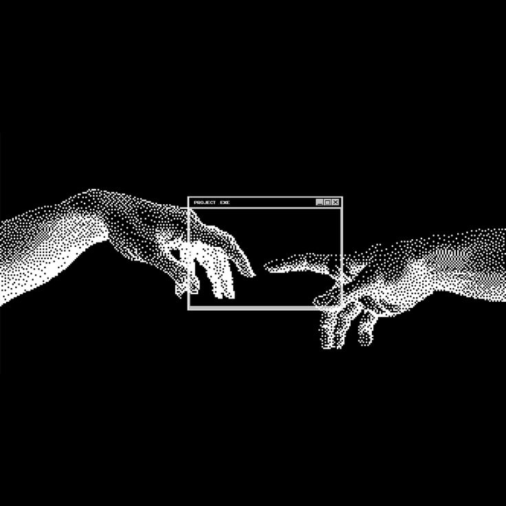
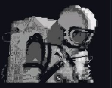

# Hi 👋, I'm Dokizer

### 🤖 AI Developer & Systems Engineer
**Human after all — bridging human creativity with artificial intelligence**

*Building intelligent neural systems, autonomous agents, and scalable backend architectures.*

---

### 🚀 About Me

<table>
  <tr>
    <td width="65%" valign="top">
      

        <strong>Dokizer, Here</strong> — an <strong>AI Developer & Software Engineer</strong> dedicated to building next-generation intelligent applications and scalable software systems.
      

      

        I enjoy developing production-ready AI pipelines, experimenting with modern <strong>LLMs, Autonomous Agents</strong>, fine-tuning neural models, and crafting high-throughput backend APIs.
      

      

        Currently delving into <strong>PyTorch, LangChain, FastAPI, Docker, and Vector Databases</strong>, while pushing the boundaries of human-machine symbiosis.
      

      

        <em>My philosophy is simple: write clean code, architect resilient systems, and leverage AI to build things that matter.</em>
      

    </td>
    <td width="35%" align="center" valign="middle">
      
    </td>
  </tr>
</table>

---

### 🤝 Connect With Me

  
  
  
  

---

### 💻 Tech Stack & AI Arsenal

  

  
  
  
  
  
  
  
  

---

### 📊 GitHub Stats

  

  

---

### 📈 Activity Graph

  

  ✦ Crafted with neural precision • Human after all ✦

